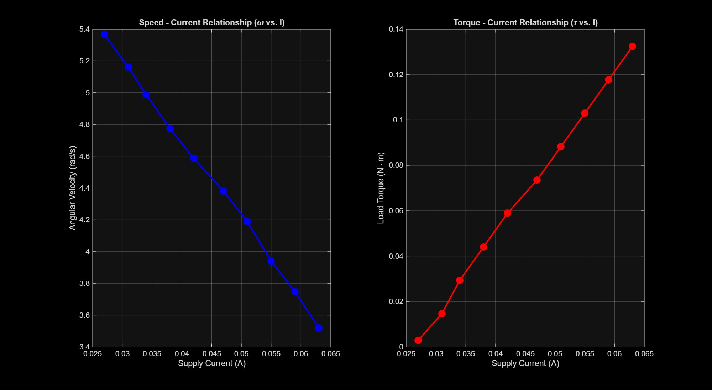

# PMDC Motor Characterization Toolbox (`pmdc_toolbox`)

## Overview & Purpose
To safely and effectively control the two-finger underactuated prosthetic hand, it is critical to understand the hardware limits, load capacities, and stress conditions of the actuators driving the compliant mechanism[cite: 1]. Furthermore, establishing an accurate empirical motor model is essential for designing advanced, dynamics-based control algorithms[cite: 1].

This toolbox provides the embedded firmware (ESP32/Arduino), data logging utilities, and MATLAB analysis scripts required to experimentally determine the key electromechanical characteristics of Permanent Magnet DC (PMDC) motors[cite: 1, 2, 4]:
* **No-Load Speed ($\omega_0$):** Rotational speed of the motor at rated voltage under zero external load[cite: 1].
* **No-Load Current ($I_0$):** Baseline steady-state current drawn by the motor under no load[cite: 1, 2].
* **Speed–Current Relationship ($\omega$ vs. $I$):** How angular velocity degrades as current draw (and load) increases[cite: 1, 3].
* **Torque–Current Relationship ($\tau$ vs. $I$):** The electromechanical coupling between supply current and output shaft torque[cite: 1, 3].
* **Stall Current ($I_{\text{stall}}$) & Stall Torque ($\tau_{\text{stall}}$):** Maximum current drawn and torque produced when the output shaft is constrained at zero rotational speed[cite: 1, 2].
* **Motor Response Time:** Transient time required for the motor to respond with movement following a step stimulus[cite: 1].

---

## Hardware Setup

### Motors Tested
1. **Solid Shaft JGY370 DC12V Worm Reduction Motor**
   * **Rated Voltage:** 12 V DC[cite: 1]
   * **Max Current:** ~2 A under maximum shaft load[cite: 1]
   * **Feedback:** External AS5600 magnetic encoder with a diametrically polarized magnet mounted on the shaft[cite: 2].
2. **Waveshare DCGM-3865-12V-EN-240RPM**
   * **Rated Voltage:** 12 V DC[cite: 1]
   * **Theoretical Max Speed:** 240 RPM[cite: 1]
   * **Feedback:** In-built quadrature encoder for angular position measurement[cite: 1, 2].

### Electronics & Instrumentation
* **Microcontroller:** ESP32[cite: 2]
* **Motor Driver:** BTS7960 High-Current DC Motor H-Bridge Driver[cite: 2]
* **Position Sensor (for JGY370):** AS5600 Magnetic Encoder[cite: 2]
* **Power & Current Measurement:** Wanptek Programmable DC Power Supply (used for constant voltage supply and steady-state current readout)[cite: 2]

---

## Methodology & Principles

### 1. No-Load Speed and Current
* Angular position ($\theta$) is read either from the AS5600 magnetic encoder (for the JGY370 motor) or from the built-in encoder (for the Waveshare motor)[cite: 2].
* By sampling the angular position at a fixed rate, the discrete-time angular velocity ($\omega_k$) is computed as[cite: 2]:
  $$\omega_k = \frac{\theta_k - \theta_{k-1}}{t_k - t_{k-1}}$$
* The steady-state no-load current is read directly from the programmable DC power supply once the motor reaches steady state[cite: 2].

### 2. Speed–Current and Torque–Current Relationships
* The motor is driven at a fixed PWM value under a constant DC supply voltage[cite: 2, 3].
* Known calibration weights ($m$) ranging from **50 g to 450 g** (in steps of 50 g) are attached to the motor shaft via a pulley of known radius ($r$) and cable mechanism[cite: 2, 3].
* The resistive load torque ($\tau$) applied to the shaft is calculated via[cite: 2]:
  $$\tau = m \cdot g \cdot r$$
* For each load increment, the steady-state angular speed ($\omega$) and supply current ($I$) are recorded[cite: 2]. The average angular speed and torque are calculated for each load and plotted against their respective current values using a MATLAB script (`current_speed_torque_relationship.m`)[cite: 2, 4].

### 3. Stall Current and Torque
* **Stall Current:** Measured directly from the DC power supply by mechanically constraining the motor shaft at a small voltage for 1–2 seconds[cite: 2].
* **Stall Torque:** Measured using a load cell while the shaft is constrained[cite: 2].

---

## Repository Structure

* `ang_pos_measurement.ino` – Firmware to read raw angular position from encoders[cite: 4]
* `ang_vel_measurement.ino` – Firmware for real-time angular velocity calculation[cite: 4]
* `torque_current_speed_relationship.ino` – Firmware for running fixed-PWM load tests[cite: 4]
* `pid_pmdc_control.ino` – Closed-loop PID control implementation for the PMDC motor[cite: 4]
* `config.h` / `new_config.h` – Configuration headers for hardware pins and parameters[cite: 4]
* `motor_characterization_data.csv` – Logged experimental dataset[cite: 4]
* `current_speed_torque_relationship.m` – MATLAB script to process data and generate characteristic plots[cite: 2, 4]
* `motor_characteristics_plot.jpg` – Generated Speed–Current and Torque–Current characteristic curves[cite: 4]
* `README.md` – Project documentation[cite: 4]

---

## Experimental Results

### Waveshare DCGM-3865-12V-EN-240RPM

#### 1. Experimental Test Parameters
* **DC Supply Voltage:** 12 V[cite: 3]
* **PWM Value:** 50 (on an 8-bit scale of 0 to 255)[cite: 3]
* **Power Supply Current Limit:** 3 A[cite: 3]
* **Applied Loads:** ~0 g to 450 g (in steps of 50 g)[cite: 3]

#### 2. Measured Motor Parameters

| Parameter | Measured Value |
| :--- | :--- |
| **No-Load Speed ($\omega_0$)** | 51.2483 RPM (~5.37 rad/s)[cite: 3] |
| **No-Load Current ($I_0$)** | 0.027 A[cite: 3] |
| **Stall Current ($I_{\text{stall}}$)** | *TBD*[cite: 3] |
| **Stall Torque ($\tau_{\text{stall}}$)** | *TBD*[cite: 3] |
| **Motor Response Time** | *TBD*[cite: 3] |

#### 3. Speed–Current ($\omega$ vs. $I$) and Torque–Current ($\tau$ vs. $I$) Data
From the experimental characterization plots across the 10 load steps (0 g to 450 g in 50 g increments), the steady-state data points are observed as follows[cite: 3]:

| Load Step (g) | Supply Current $I$ (A) | Angular Velocity $\omega$ (rad/s) | Load Torque $\tau$ (N·m) |
| :---: | :---: | :---: | :---: |
| **0 (No Load)** | 0.027 | 5.37 | 0.000 |
| **50** | 0.031 | 5.16 | 0.015 |
| **100** | 0.034 | 4.99 | 0.029 |
| **150** | 0.038 | 4.78 | 0.044 |
| **200** | 0.042 | 4.58 | 0.059 |
| **250** | 0.047 | 4.38 | 0.074 |
| **300** | 0.051 | 4.19 | 0.088 |
| **350** | 0.055 | 3.94 | 0.103 |
| **400** | 0.059 | 3.74 | 0.118 |
| **450** | 0.063 | 3.52 | 0.132 |

#### 4. Key Observations from Characteristic Curves
* **Speed–Current Relationship ($\omega$ vs. $I$):** As mechanical loading increases from 0 g to 450 g, the supply current increases from **0.027 A to 0.063 A**, while the angular velocity decreases linearly from **5.37 rad/s to 3.52 rad/s**[cite: 3].
* **Torque–Current Relationship ($\tau$ vs. $I$):** Output load torque scales linearly with supply current draw, rising from **0 N·m at 0.027 A** (no-load current $I_0$) up to **0.132 N·m at 0.063 A**[cite: 3].

---

## Contributors
* **Ayush Kumar**[cite: 1]
* **Maitreyee**[cite: 1]